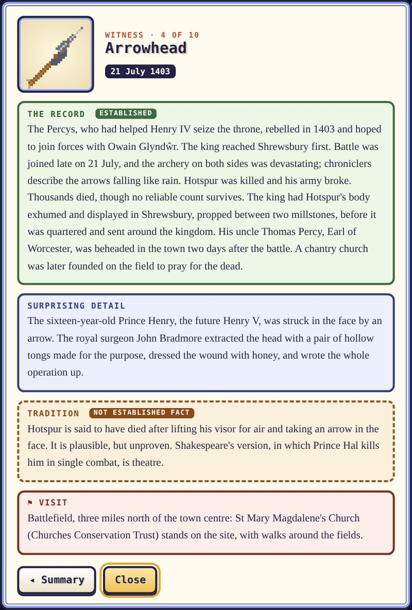

## What it is

*Shrewsbury: An Unfinished Survey* is a top-down exploration game about the real history of Shrewsbury, written for adults. In 1887 a fictional antiquarian, Augustus Thorne, F.S.A., set out to tell the town's story through ten objects he called "witnesses". He died before finishing. You arrive at the station with his document box and a map that is blank past the forecourt.

You walk the streets to clear the fog from his map and talk to five townsfolk, from an archivist at the library to a retired maltster. You also find the ten witnesses: a coin from Roman Viroconium, a stone from the Norman castle, an arrowhead from the Battle of Shrewsbury in 1403, a sketch of finches for Darwin, an iron column from the Ditherington Flaxmill, and a notebook belonging to Wilfred Owen. Each one you log opens up more of the town.

**[Play it in your browser](https://thatadamroberts.github.io/ShrewsburyExplorer/)**. It works on phones, and you can install it as an app that runs offline.

## Why I built it

<!-- TODO: Write this in your own words. What's your connection to Shrewsbury, and why a game rather than a guide or a website? -->

## Fact, legend and the gap between them

The rule I cared most about was keeping fact and folklore apart. Each witness has a short summary and a longer "read more" entry. The longer entry shows the established record in one box and a surprising detail in another. Any legend, tradition or disputed claim goes in a third box with a dashed border, clearly labelled **Not established fact**.

So the Arrowhead entry tells you that sixteen-year-old Prince Henry, the future Henry V, really was shot in the face at the battle. The royal surgeon pulled the arrowhead out with tongs made for the job, dressed the wound with honey and wrote the operation up. The entry is equally clear that the story of Hotspur dying after lifting his visor is only a tradition. Darwin's "eureka among the finches" is marked as a popular myth, and the entry for the Abbot's House points out there's no evidence an abbot ever lived there. Each entry ends with where you can see the real thing today.

## The town as data

The whole game is one `index.html` file, about 2,200 lines of vanilla JavaScript on a canvas, with no images. The content sits in plain, labelled objects at the top of the script:

- `MAP_DATA`: the river's course, the streets and the landmarks on a 100 × 80 tile grid
- `ZONES`: the districts
- `RELICS`: the witnesses
- `NPCS` and `SIGNS`: the townsfolk and 27 readable plaques
- `ROUTE`: a real walking route

The Severn is a list of points around which the game draws the river, looping south around the town and leaving only the narrow neck of land where the castle stands, which is the reason the castle is there. When the game loads, it draws the whole town onto one off-screen canvas, and each frame just draws that one image, shifted to follow the camera.

Because the content is data, someone else can edit it. The game checks itself when it loads: it flood-fills the map from the station, and if a relic, character or sign ends up somewhere the player can't reach, it prints a warning in the browser console.

## Clearing the fog

The fog is stored at twice the map's resolution, as one byte per cell. As you walk, cells within five tiles are revealed, with a smooth falloff so the edge looks soft. Only the changed rectangle of the fog image is redrawn.

The "explored" percentage only counts cells you can actually reach, using the same flood fill, so the finale's requirement of 98% explored is always possible. The districts open in stages:

| Witnesses logged | District opened |
| --- | --- |
| 0 | the town centre, including the castle, the library, Pride Hill and Butcher Row |
| 2 | Mardol, the Welsh Bridge, St Chad's and the Quarry |
| 4 | Wyle Cop, the English Bridge and the Abbey |
| 8 | Castle Foregate and the Flaxmill |

## An app that works offline

The game is a Progressive Web App. A web manifest and a small service worker let you add it to a phone's home screen and play with no signal. That matters for a game you might take on a walk around the town it describes.

A GitHub Actions workflow publishes it to GitHub Pages on every push. It stamps the service worker's cache version with the commit hash, so installed copies pick up updates automatically. Even the home-screen icons are rendered from the game's own sprites, by a small Playwright script.

## Built with Claude Code

<!-- TODO: The commit history shows the game was built in a Claude Code session. You might cover who researched and checked the history, and how you made sure the "established" claims hold up. Delete this section if you'd rather not mention it. -->

## What's next

<!-- TODO: Plans? For example, more witnesses, other towns, audio, or feedback from people who played it in Shrewsbury. -->
